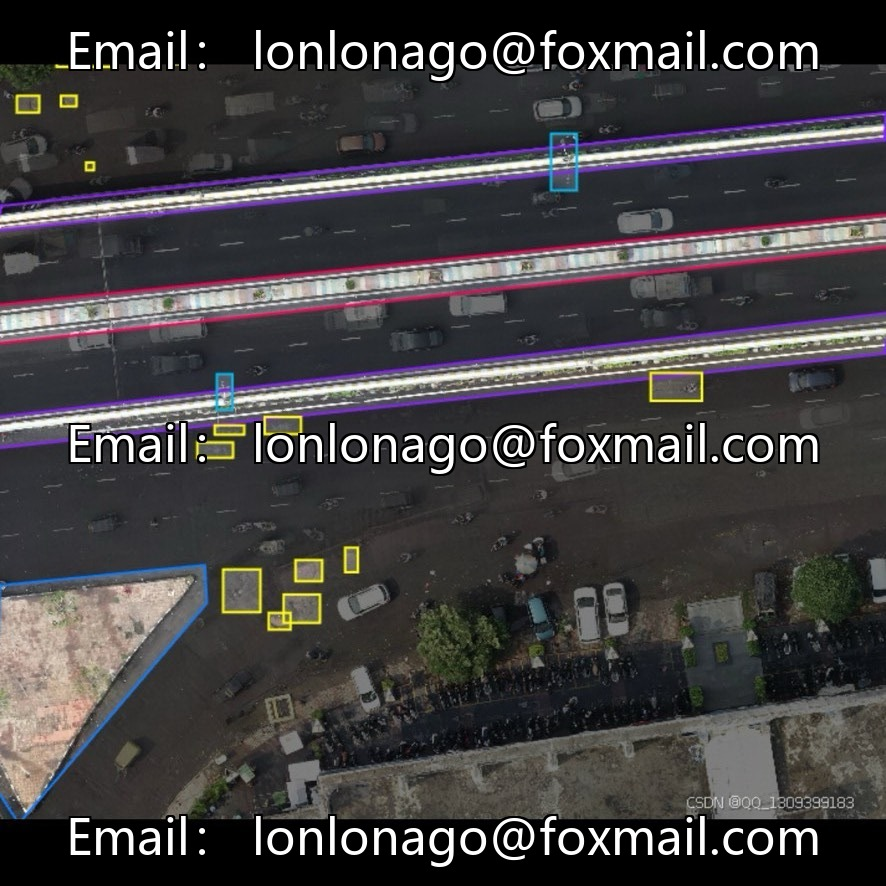
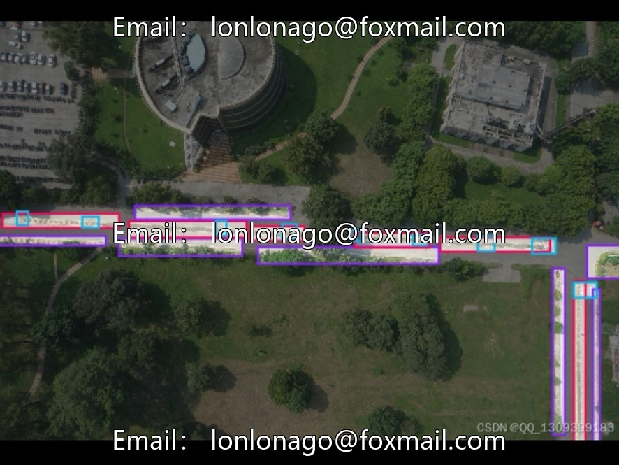
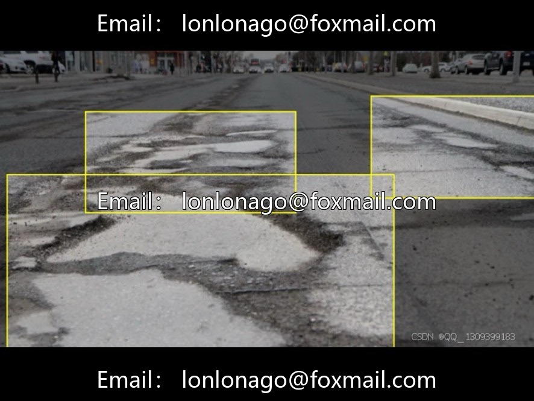
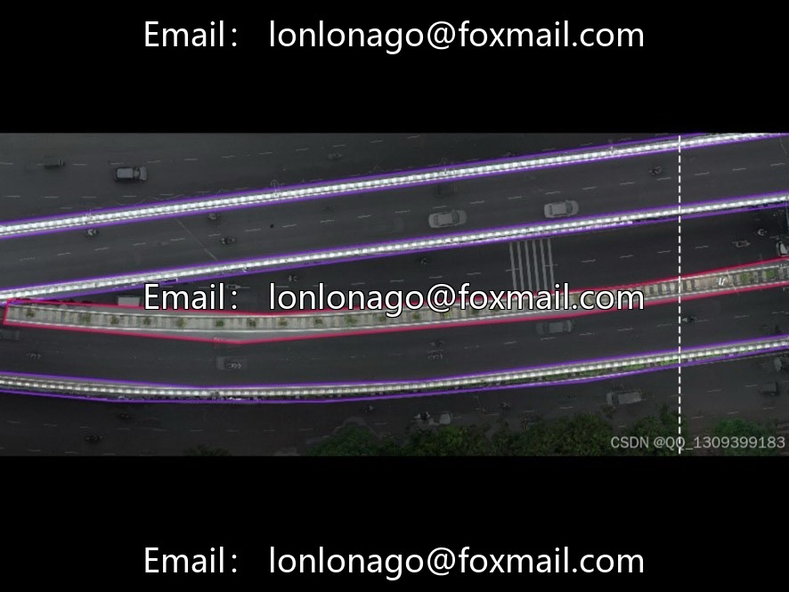
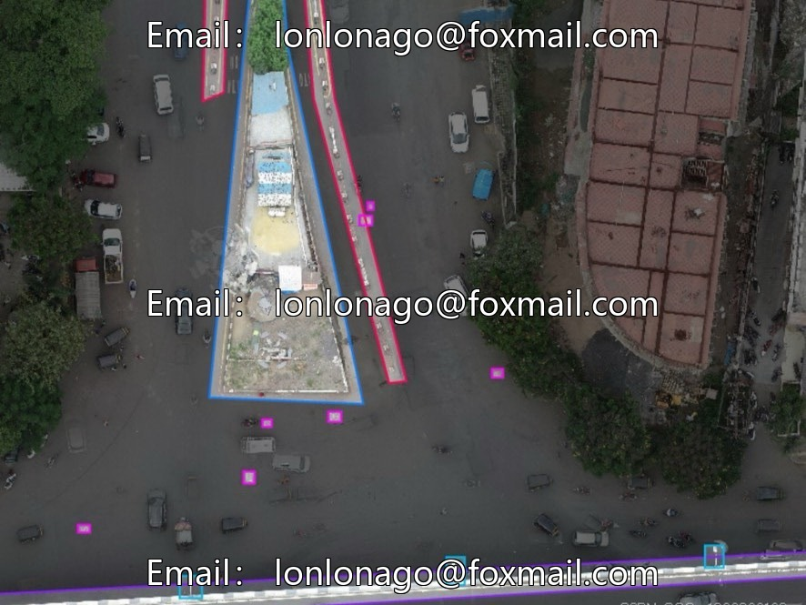
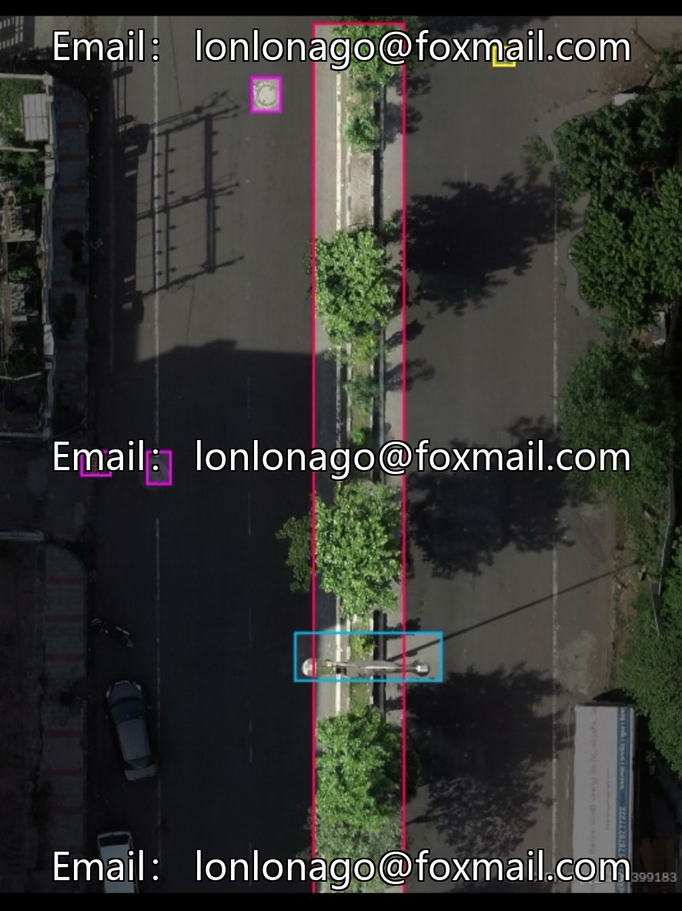
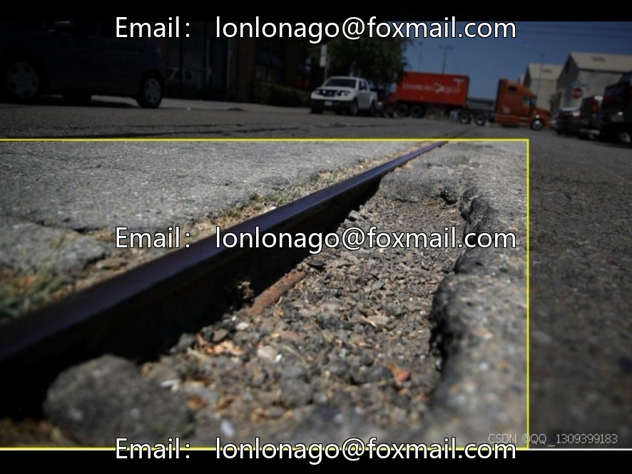

# DJI Aerial Inspection Road Defects Multi-Object Detection Dataset, Issue 10043

## Body

DJI Aerial Inspection Road Defects Multi-Object Detection Dataset, Issue 10043
Comprising 4300 aerial photographs, 12 subsets, categorized by road type and weather period, from an aerial perspective, covering urban roads, rural highways, and multi-lighting scenarios.
Complete labeling for 9 categories: Damage (road defects), Divider (road divider facilities), Road-Divider (separation greenbelt), Seepage-Hole (drainage hole), Side-Fence (protective fence), Speed-Breaker (speed bump), Street-Light (street light), Street-Pol (pole-like object), Traffic-Light (traffic signal).

Dataset Split: Training set approximately 80%, validation set 10%-15%, test set 5%-10%;
Subsets can be individually split for specialized scenario training.
Image Resolution: 1280×720 to 4096×2160 high-definition specifications, balancing precision and training computational power.
Core Application Scenarios: Road intelligent maintenance, autonomous driving environment perception, urban infrastructure surveying, traffic optimization dispatch, road safety warnings, etc.
Data format is image files, with clear and accurate annotations, compatible with mainstream algorithm training needs.
Virtual materials, once sold, are non-refundable.
Interested friends, click "I want" now!

## Images

## Payment

Here is a pay link on Stripe ( https://buy.stripe.com/3cs8yP7sY87d0vu9AB ). Please contact me lonlonago@foxmail.com after funding $89, and I will send you a complete data files , thank you!

